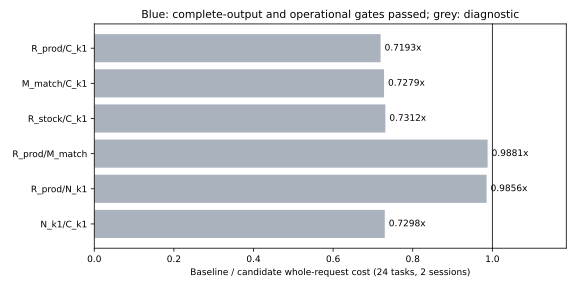
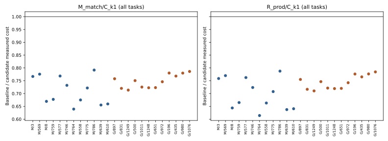
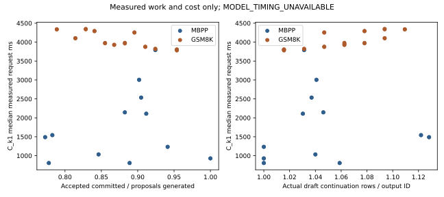
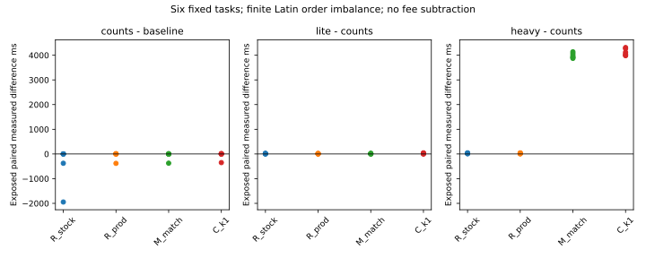

# B570 PR90 evidence closeout

The fixed Q6_K target/Q4_K_M draft, k1 study completed1200/1200 formal requests and50/50 warmups across24 new inputs,5 arms,5 rounds and2 consecutive sessions. Engineering used334 units (core234, profiling100), giving1584/1634 total paid units. There were no formal retries, overwritten slots, endpoint crops or outcome-dependent choices.

The stable R_stock reference passed all 240 native requests. R_prod, M_match and C_k1 each diverged on GSM8K/test/1248 and GSM8K/test/831 in every round/session (20 mismatching requests per arm). Their first differing output ID indices are 47 and 81, respectively (zero-based). N_k1 has 80 mismatching requests. Consequently, every preregistered comparison has request_qualified_ratio = null under the frozen R_stock reference gate. No baseline reanchoring or task exclusion is used to admit a ratio.

The measured diagnostic R_prod/C_k1 ratio is 0.719264 and M_match/C_k1 is 0.727927; C_k1 therefore costs about 39% and 37% more per measured output window. Both comparisons regress on all 24 tasks. These are diagnostic costs of the actual windows, not qualified same-output speedups. The new-cohort result does not certify the engineering sample's complete-output equivalence.

Complete-output qualification and operational memory are assessed per comparison. Physical residency remains UNKNOWN: no same-scope ETL/allocation certificate exists, so strict resident qualified ratios remain null. The following request ratios include all required native and host work in the frozen counts channel.

| Comparison | Request-qualified ratio | Diagnostic complete cost ratio | MBPP qualified | GSM8K qualified | Negative tasks |
|---|---:|---:|---:|---:|---:|
| R_prod/C_k1 | null | 0.719264x | null | null | 24 |
| M_match/C_k1 | null | 0.727927x | null | null | 24 |
| R_stock/C_k1 | null | 0.731243x | null | null | 23 |
| R_prod/M_match | null | 0.988099x | null | null | 24 |
| R_prod/N_k1 | null | 0.985591x | null | null | 14 |
| N_k1/C_k1 | null | 0.729779x | null | null | 24 |

Ratios are baseline fee divided by candidate fee, with five-round medians per task/session, equal task log weights and an equal average over the two sessions. Values below1 are regressions. All negative task/session/domain effects and N divergences are retained. Same-day sessions do not support date-level confidence intervals.

The repaired target continuation has actual occupied query width1. For k1 its logical verification width2 is executed as two successful native micrographs; capacity4 stays fixed. This is the existing Vulkan repair, not a transferred parallel query-batch algorithm. Actual draft proposal/catch-up rows, five proposal fates, output sources and cycle progress are preserved and checked independently.

Post-source scope audit: inherited phase binding calls synchronize() and may reserve buffers. The literal lite CPU-only binding-hook label is inaccurate and is retained with this correction; it does not support component coefficients. The synchronization integer covers direct worker calls only; source-derived binding synchronizations are listed separately. Whole fees already include all those inherited waits, and formal observer flags concern only added observation synchronization. No frozen actor or formal record was changed.

All96 exposure profiling slots were measured. Lite hooks retain asynchronous decode-enqueue/sample wait spans and do not produce a mutually exclusive completed-wall partition. MODEL_TIMING_UNAVAILABLE is frozen before formal startup; coefficients, predicted curves, MAE/MAPE and direction accuracy remain unavailable. Heavy KV readbacks, added synchronization and memory observations never calibrate formal cost. No observer-cost estimate is subtracted.

MBPP population: complete sanitized-mbpp.json at the exact fixed Google commit e49bbfe381c9c0e564b937f1c4e163a2273c65cc. The conservative accessible-history exclusions left only1 eligible task in the inherited test-only interval; PR90 specifies no split restriction, so the full same-revision sanitized population was prospectively bound before any formal forward. Selected splits are2 train,3 validation and7 prompt examples; exact splits are recorded per ID. This is a finite cost/output study with no training-unseen or accuracy claim. GSM8K uses only the fixed test questions; answers/tests/solutions are absent from online input.

Owned GPU process lifetime: 4009.123s /28800s. Minimum actual formal checkpoint headroom: 1429467136 bytes, threshold536870912. All actual loaded weights/KV were placed on Vulkan0 with owned PID/PCI/LUID evidence. Checkpoints do not establish continuous physical residency or absence of unobserved paging.

Native arithmetic/model/sampler/template files and the four GGML DLL bytes stay unchanged. Private context changes add only successful-micrograph integer counters and read/reset exports. The full source, binaries, native arrays, command/module/weight/KV/memory logs, request ledgers, observation variants, pre-formal source freezes and preserved preparation deviations are archived. Publisher bytes are bound; upstream conversion ancestry remains uncertified.

Independent verification imports no executor or fitting helper. It recomputes endpoint signatures, counters, exact equal-task statistics, qualification, source/model/vocabulary bindings and complete budgets. Whole host-clock fee scalars are crosschecked with ledger/native elapsed/UTC envelopes; original QPC endpoints were not separately exported. Heavy full KV vectors were compared in the native guard and not retained for offline byte comparison.

Archive restoration receipts are supplied separately for a fresh local restore and actual authenticated GitHub blob restoration. Old#88 stopped study, manuscript and release are unchanged; this result remains Draft.
