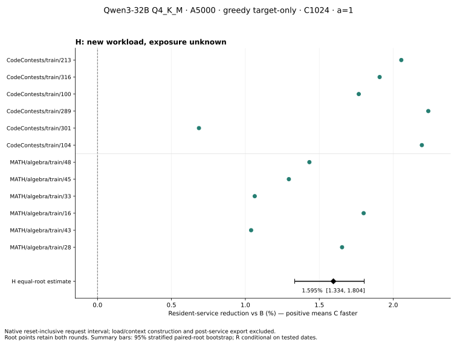

# H: prospectively selected new workload (completed)

H completed independently before either R date. Under the original 32B target-only deployment, C/B resident-service ratio is **0.9840468605**, a **1.5953% reduction**. The 95% paired-root bootstrap interval for the reduction is **[1.3335%, 1.8039%]** (ratio [0.9819610645, 0.9866648394]). All 24 measured pairs and all 12 root means favor C, including the smallest root effect, CodeContests/train/301 at 0.6860%. No samples were removed or retried for performance.

This is one prospectively selected workload panel. **All 12 roots have unknown later development exposure.** Input-only selection exactly reproduces the frozen PR manifests. The later surviving-record scan found no chosen IDs, normalized-text matches or prompt-token matches, but it cannot prove development-unseen or training-unseen status. H does not replace R, establish a population of dates, or demonstrate acceleration in all deployments. The historical S3 1.5136% result is context only and contributes no rows to this estimate.



## Deployment, qualification and timing

The original full Qwen3-32B-Q4_K_M GGUF, R ELF, shared B/C ELF and 3,432-file compiled closure match the retained S3 artifacts. Actual loaded modules were checked per successful worker. Same original A5000 physical allocation, C1024, a=1, WHOLE/SIMPLE, greedy k=0, target-only, two threads, F16 KV, graphs/flash off and cap128. B uses shared quantization then the backend scalar loop; C uses independent scalar groups. No native arithmetic, output contract or clock code was rebuilt. The host has rebooted since historical S3; driver/environment observations are retained, so old/new differences cannot be attributed solely to date.

All 12 roots passed two pristine R repetitions followed by each candidate's heavy/clean bridge using the original strict readers: complete vocabulary outputs, active KV and logical/pending/termination state, including ordinary continuation. Every formal warmup and measured request passed the original complete output/tape/final vector/terminal active-KV check against its assigned R reference after its timer. There were no numerical mismatches. Existing EOG/cap/reset fixtures remain finite evidence for unchanged native code, not new qualification on every possible input.

The native CLOCK_MONOTONIC interval includes reset, planning, prefill/decode, owned output and final synchronization. Load/context construction, heavy observation and post-service terminal export are excluded. Raw timestamps, reset-empty evidence and zero context-create/heavy-capture/export/import calls inside clean service were independently checked. This result concerns resident requests, not process or campaign wall time.

H began UTC 2026-11-13 15:00:22.999949 and completed 17:38:07.260824 (Beijing Nov 13 23:00 through Nov 14 01:38). Formal workers ran UTC 17:02:28–17:38:06, entirely on Beijing Nov 14. Start-to-completion wall was 9,464.261s including repair gaps. STATUS.panel_wall_s records only the final resumed attempt (8,620.296s); it must not be mistaken for total H wall. No computation/panel deadline was applied.

## Consumption and failures

| Stage | Charged requests | Successful | Failed starts | Conservative rows | Actual forward rows |
|---|---:|---:|---:|---:|---:|
| Qualification | 74 | 72 | 2 | 17,422 | 16,788 |
| Warmup | 48 | 48 | 0 | 11,240 | 11,192 |
| Measured | 48 | 48 | 0 | 11,240 | 11,192 |
| H total | **170 / 176** | **168** | **2** | **39,902 / 56,320** | **39,172** |

There were 97 native process starts: 96 successful and one rejected before model/context/forward work. Its two logical heavy/clean requests remain charged. The complete R+H projection is 446 requests /101,534 conservative rows, within the 468 /149,760 ceilings, with no old allowance reused.

Two repair records are retained in [REPAIRS.json](../REPAIRS.json) and the raw packet. First, duplicate UTC metadata stopped exit journaling after a successful reference; its original HOST/native evidence was reconciled and reused without a new model request. Second, a qualification grant used S1 where the unchanged native ABI requires S3_QUAL; native admission rejected before model loading. Its original failed job remains, and one explicitly registered replacement with identical job bytes passed. No formal pair was rerun.

Sampled resource checks found minimum GPU free memory 5,412,749,312 bytes, maximum used 19,873,660,928 bytes, minimum available RAM 526,874,357,760 bytes and minimum free disk 2,261,532,794,880 bytes. These are sampled values, not continuous peak guarantees. No interference or device reset was observed. The existing unrelated task was not changed. All 91 protected historical source/STATE/journal files remain unchanged.

## Estimates, order and phases

Each root averages log(C/B) over its two order-reversed rounds; the panel equally weights all 12 roots. The 20,000-draw, seed20261113 bootstrap resamples whole roots separately within six code and six math roots, retaining both rounds. For the predeclared R/H family the additional H 97.5% interval is ratio [0.9817395765, 0.9870417877], or reduction [1.2958%, 1.8260%]. R is pending; no completed two-panel family conclusion is claimed yet.

Descriptive code and math reductions are 1.8092% and 1.3810%. With B first, geometric C/B is 0.9842670 across 12 pairs; with C first, 0.9838267 across 12 pairs. These order/domain views are descriptive, not extra independent confirmations. [PER_ROOT.csv](PER_ROOT.csv) and [ANALYSIS.json](ANALYSIS.json) retain every root, round, pair and domain.

| Measured-only totals (24 requests/arm), seconds | B | C |
|---|---:|---:|
| Native resident service | 190.477095 | 187.266841 |
| Prefill | 79.958266 | 76.681033 |
| Ordinary decode | 108.432995 | 108.499254 |
| Reset | 0.002960 | 0.002922 |
| Planning | 0.002761 | 0.002676 |
| Owned-output copy | 0.143060 | 0.143506 |
| Unpartitioned residual | 1.937054 | 1.937451 |

Phase sums describe these requests; their ratio is not the equal-root primary estimator. C decode is slightly slower in aggregate and is retained. The resident difference is concentrated in prefill in this panel.

## Saved evidence and independent replay

[RAW_TEXT.tar.gz](RAW_TEXT.tar.gz), 3,857,693 bytes, SHA256 `c8567c0dee4268f72c124a7dd7811fc88f804916f28b9006ea1aceb19c4f5ba8`, contains 4,641 text payload files plus INDEX.json: actual receipts/timestamps, jobs/identities/tokens, semantic tapes, per-worker check proofs, all attempts/failures, source versions, resource aggregate, protected-file audit, disposal inventories and 9,770 retained numerical-file commitments. Private host paths/device UUID/network addresses are removed. Numerical tensors are retained only on the host under the documented bounded retention; the public archive contains no model weights or tensor bytes.

An independent JavaScript reader reconstructs all 96 clean timing rows from raw native receipts, validates operation order/clock boundaries/output identities/work metadata, reconciles every charged request and actual row, then independently reproduces the point estimate and both bootstrap intervals. Host and public packet replays pass; see [INDEPENDENT_PUBLIC_REPLAY.json](INDEPENDENT_PUBLIC_REPLAY.json). This is saved-text/statistical replay, not an independently repeated numerical/GPU run. Original private job/runtime-config hashes are checked in host replay; public mode explicitly omits those path-dependent checks after redaction and verifies the public member INDEX instead.

```
mkdir fresh-packet
tar -xzf RAW_TEXT.tar.gz -C fresh-packet
node ../replay.js fresh-packet fresh-replay public
```

No additional model requests are used by reporting, plotting or replay. R1/R2 remain pending at this checkpoint. H supports recurrence of a small resident-service advantage on this workload under this deployment; it does not justify a 5% target or broaden the paper's deployment-wide claims. The paper is unchanged and no merge/submission occurred.
