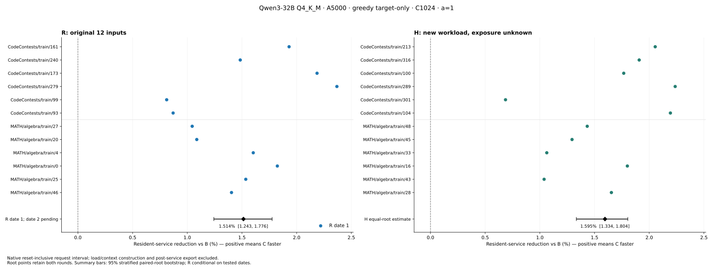

# R date 1: Beijing 2026-11-14 (completed)

On the original 12 S3 inputs, the first new date gives equal-root **C/B = 0.9848626556**, a **1.5137% resident-service reduction**, with 95% reduction interval **[1.2429%, 1.7759%]** (ratio [0.9822414942, 0.9875706874]). All24 measured pairs and all12 root means favor C. The smallest root effect, CodeContests/train/99 at0.8118%, is retained. No native failures or performance retries occurred on this date.

**R2 has not run. The registered combined R estimate is NOT_COMPLETE.** This result supports recurrence on this first date only; it is not a distribution-of-days result, an equivalence result with historical S3, or a universal deployment claim. Historical S3's1.5136% is a separate comparator and contributes no rows. H remains separately reported, with later development exposure unknown for every input.



## Qualification, execution and dates

The original full32B GGUF, R ELF, shared B/C ELF, state profile and3,432-file compiled closure match retained identities. Actual loaded modules match per successful worker. Both R dates use frozen dated controller **9a0046ab9fd2a1e4a4a2a915a8265b848afb3d71**, the same original A5000 physical device and the same successor journal. Same C1024, a=1, WHOLE/SIMPLE, greedy k=0, target-only, reserve/microbatch32, two threads, F16 KV, common graphs/flash off and cap128.

All12 roots passed two pristine R repetitions and both heavy/clean candidate bridges before formal timing. The original readers require finite complete151936-dimensional F32 vectors and all64-layer active F16 K/V to match byte for byte, along with pending/logical/termination state and subsequent ordinary continuation. All96 formal warm/measured requests then passed the complete output/tape/final-vector/terminal-active-KV checks after their timers. Intermediate vector/KV comparisons are not repeated inside clean timing. Every request reached the unchanged CAP128; no natural early EOG is new evidence from this panel.

The native reset-inclusive monotonic clock is unchanged: reset/planning/prefill/decode/owned output/final synchronization included; load/context construction and post-service export excluded. Clean requests contain no heavy capture, online reference replay, state import/export or context creation inside service. See [EXECUTION.md](../EXECUTION.md) for the outside-clock caller differences: per-panel model preflight and no extra historical fixed3s gaps. Those differences and the historical reboot prevent a causal date-only old/new comparison. One matched warmup per fresh process does not establish general steady state.

R1 START after preflight was UTC19:00:22.752300; full qualification closed20:48:48.778883. Formal reservations/exits span20:48:49.990217–21:23:59.260697, entirely Beijing Nov14 04:48–05:24. R1 completed UTC21:24:00.183341. Panel wall including preflight was8,639.831s; START-to-complete excluding initial preflight was8,617.431s. HOST launch-to-exit-observation includes polling/module validation and excludes prelaunch checks; nested load/service/export intervals must not be added to it.

R2's deterministic earliest start is **UTC2026-11-14 21:24:01.183341 / Beijing Nov15 05:24:01**, completed R1 +24h+1s. It will requalify fixed sentinel slots0/6 and check every warm/measured endpoint against its assigned reference. The GPU is now idle18MiB with no selected process, and all three execution locks were probed free. R2 still checks actual resource availability before launch; no other task is evicted. No computation/panel deadline applies.

## Actual consumption

| R1 stage | Charged requests | Conservative rows | Actual forward rows |
|---|---:|---:|---:|
| Qualification,48 fresh workers | 72 | 16,092 | 16,020 |
| Warmup | 48 | 10,728 | 10,680 |
| Measured | 48 | 10,728 | 10,680 |
| R1 total,96 fresh workers | **168** | **37,548** | **37,380** |

H remains170 charged requests /39,902 conservative /39,172 actual rows, including its two charged pre-model startup failures. Combined spending to this checkpoint is **338/468 requests,77,450/149,760 conservative rows,76,552 actual forward rows**:336 successful logical requests plus2 failed starts across193 native starts. No old quota was borrowed or reset. Remaining registered R2 is108 planned requests /24,084 conservative rows; projected complete total remains446 requests /101,534 rows.

The qualification and formal launch-to-exit-observation sums are4,787.669s and1,987.734s. Formal model load169.364s and pool setup2.232s are nested inside the latter, outside service. All91 protected historical source/STATE/journal files remain unchanged. R1's2,829 existing resource samples give minimum GPU free5,412,749,312 bytes, maximum used19,873,660,928 bytes, minimum available RAM526,914,768,896 bytes, minimum disk free2,236,801,134,592 bytes and maximum host load fraction0.04165. These are sampled values, not continuous peak measurements.

One post-completion read-only reporting probe initially lacked the original support import path; importing verify before host, as the native controller does, repaired it. [REPORTING_FAILURES.json](REPORTING_FAILURES.json) retains that zero-model-call error. It did not change experiment data, consume requests or constitute a native R1 failure. Earlier H failures remain in their original attempts and [REPAIRS.json](../REPAIRS.json).

## Estimation, order and phase accounting

Each root averages log(C/B) across its two order-reversed rounds, then all12 roots receive equal weight. The20,000-draw, seed20261113 bootstrap resamples whole roots within six-code/six-math strata, preserving rounds. Per-date intervals describe this date. The planned R/H family analysis awaits combined R after R2; the per-date97.5% sensitivity interval in ANALYSIS.json does not complete that family analysis.

Descriptive domain reductions are code1.6106% and math1.4168%. With B first, geometric C/B is0.98444698 over12 pairs; with C first,0.98527851 over12 pairs. [PER_ROOT.csv](PER_ROOT.csv) retains both panels with separate panel labels; [ANALYSIS.json](ANALYSIS.json) preserves every round and root. No unfavorable smaller effects are trimmed.

| Measured-only totals,24 requests/arm, seconds | B | C |
|---|---:|---:|
| Native resident service | 182.356699 | 179.420179 |
| Prefill | 71.946947 | 68.972271 |
| Ordinary decode | 108.291333 | 108.348679 |
| Reset | 0.003129 | 0.002849 |
| Planning | 0.002761 | 0.002663 |
| Owned host-output copy | 0.144991 | 0.142705 |
| Unpartitioned residual | 1.967538 | 1.951013 |

C decode is slightly slower in aggregate and remains reported. The service difference is concentrated in prefill; phase totals are descriptive and are not the equal-root primary estimator. Backend substage durations are not isolated by these data.

## Evidence and replay

[RAW_TEXT.tar.gz](RAW_TEXT.tar.gz) is7,537,685 bytes, SHA256 `fdb571f0b0b61a6139686a41544dd021bccc1495ac1afc8950cdfa9546abe38b`. It contains8,933 text payloads plus INDEX.json and commitments for19,540 retained numerical files. H and R1 receipts/timings, jobs/tokens/identities, all native failures, sources, comparison/disposal proofs and the single journal are retained together for audit, with **separate statistical estimates**. R2 contributes frozen plans only. This does not pool historical S3 or H into R1.

Independent Node replay passes for the host packet and the public packet: all192 clean warm/measured rows are reconstructed from raw receipts, original private job/runtime hashes are checked in host mode, all338 charged requests and76,552 actual rows reconcile, and both separate bootstrap estimates reproduce. See [INDEPENDENT_PUBLIC_REPLAY.json](INDEPENDENT_PUBLIC_REPLAY.json). Public paths/UUIDs are redacted; public mode explicitly omits original path-dependent config/job hash checks while verifying every transformed member against INDEX. No tensor bytes or model weights are distributed, and this is not a new GPU or full-tensor numerical replay. Immutable published-archive download/readback closure is added separately after publication.

```
mkdir fresh-packet
tar -xzf RAW_TEXT.tar.gz -C fresh-packet
node ../replay.js fresh-packet fresh-replay public
```

R2 and the combined R estimate remain unfinished. H is complete, R1 is complete, and the remaining date runs regardless of this positive first-date result. The paper's broad deployment limits are unchanged; there is no5% target, merge, paper edit or submission.
