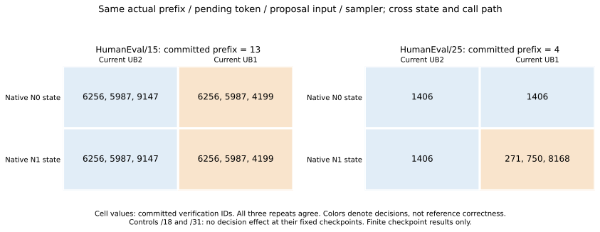
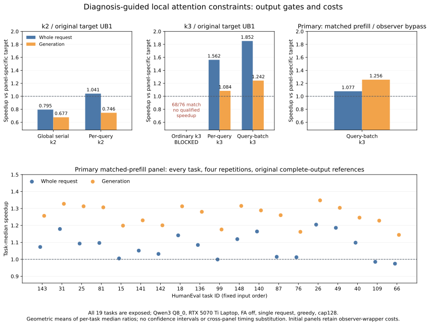

# RTX native-state diagnosis and local consistency constraints

This additive experiment extends manuscript v0.10/main e87291d, diagnostic plan #57 and pilot #58. It reproduces the original RTX intervention, crosses real native donor state with the current target verification path, then tests a diagnosis-guided attention lowering. Manuscript files and prior results are unchanged. The fixed-reference selector NO-GO in #56 remains valid.

The four-task/three-repeat native crossing yields 48 paid fork units from 24 full donor trajectories. /15 has a current-call decision effect for both donors; /25 has a donor-state/current-path interaction. /18 and /31 have no decision effect at their chosen checkpoints. All 24 natural histories and same-path decisions pass; source state is unchanged. Pinned logical KV parsing finds equal prompt K/V but differing generated-prefix K/V in70/72 tensors for all 12 donor pairs, with first-layer K/V equal. This motivates a local attention candidate, without uniquely attributing the cause.

The prototype constrains BOTH target and draft attention, including prefill and continuation, while leaving projection/FFN/output batched. Per-query subgraphs qualify but k2 generation remains slower than target-only. Folding query columns into batch axes reuses existing CUDA operations/KV broadcasts and avoids serial attention subgraphs. No extra online reference/predictor pass, recorded proposal, reference answer or task router is supplied. No new CUDA kernel or general invariance theorem is claimed.

## Retained k2 panel: 171 requests, 9 excluded warmups

| Condition | Complete ID/endpoints match | Whole-request speedup | Generation speedup |
|---|---:|---:|---:|
| Global serialization k2 | 57/57 | 0.795× | 0.677× |
| Per-query attention k2 | 57/57 | 1.041× | 0.746× |

Ratios use original globalUB1 target-only as reference and the same private executable within this panel. Request gains alone do not establish faster generation. All57/57 arrays/endpoints pass for each condition; the negative generation result is retained.

## Initial k3/UB4 panel: 304 requests, 16 excluded warmups

| Condition | Complete ID/endpoints match | Whole-request speedup | Generation speedup |
|---|---:|---:|---:|
| Ordinary k3 (blocked) | 68/76 | BLOCKED by output gate | BLOCKED by output gate |
| Per-query attention k3 | 76/76 | 1.562× | 1.084× |
| Query-batch attention k3 | 76/76 | 1.852× | 1.242× |

Every mode is repeated four times in balanced cyclic condition order. The ordinary k3 baseline fails /25 and /18 in all repetitions (68/76 matches); its measured2.063 request/1.333 generation ratios are diagnostic only, with qualified speedups null. Both constraints pass 76/76. This panel uses a globalUB1 target reference and retains disabled-observer metadata/synchronization costs, so1.852 is not isolated speculative benefit.

## Primary matched-prefill panel: 152 requests, 8 excluded warmups

| Condition | Complete ID/endpoints match | Whole-request speedup | Generation speedup |
|---|---:|---:|---:|
| Query-batch attention k3 | 76/76 | 1.077× | 1.256× |

Capture-disabled decode directly delegates to `llama_decode`, bypassing observer metadata and forced synchronization. Both modes have the same query-batch attention, UB4 and prefill; only speculation adds the 0.6B drafter. Eight complete CLI probes qualify before cost. Four repetitions alternate condition order and rotate tasks. New target references76/76 and speculation76/76 match immutable original R. Generation is faster on19/19 tasks; request wall on16/19. Aggregate ratios are geometric means of per-task ratios of four-run medians. Generation uses the engine's elapsed generation interval, including drafting/verification during that interval; whole HTTP request wall also includes uncached prompt processing, cleanup and response. Resident model loading/teardown and declared warmups are excluded.

## Interpretation and next gate

The evidence chain is native-outcome diagnosis → real state/path crossing → local consistency constraint → output-qualified cost. Continue with target/draft and prefill/continuation ablations, then exposure-audited tasks and a frozen second numerical stack. State construction and current-call execution must both be examined; this is not a proven minimal constraint or target-attention-only cause.

All 19 tasks are exposed, not reserved Stage C. Complete ID/EOG-cap128 agreement is not functional HumanEval accuracy, all-logit equality or universal losslessness. No held-out transfer, energy/throughput, confidence interval, production release or first/unique novelty is established. Existing [LLM-42](https://arxiv.org/html/2601.17768v2) and [batch-invariant inference](https://thinkingmachines.ai/blog/defeating-nondeterminism-in-llm-inference/) are explicit related-work baselines: fixed verification/cache consistency and attention reduction constraints are already studied. Differentiation must come from tested diagnostic constraint selection and cross-contract efficiency, which remain future work.

See REPORT_ZH.md, SCOPE.md and REPRODUCE.md for the detailed argument and replay steps. Results include every panel, raw-file hashes, source/binary identities and the preserved zero-model preparation failure. The local archive retains 720 complete generation requests, 48 fork units, 1278 auxiliary forwards, the frozen Git history, exact generated source and private binaries; weights/released DLLs are excluded. The ordinary-wide command metadata boolean correction and service-log observation limit are explicit in POST_AUDIT. Paper/prior datasets and model/runtime assets are preserved.

