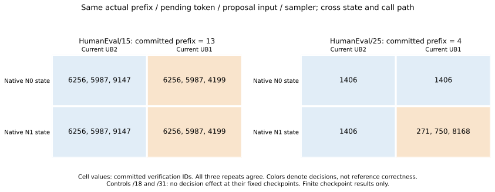
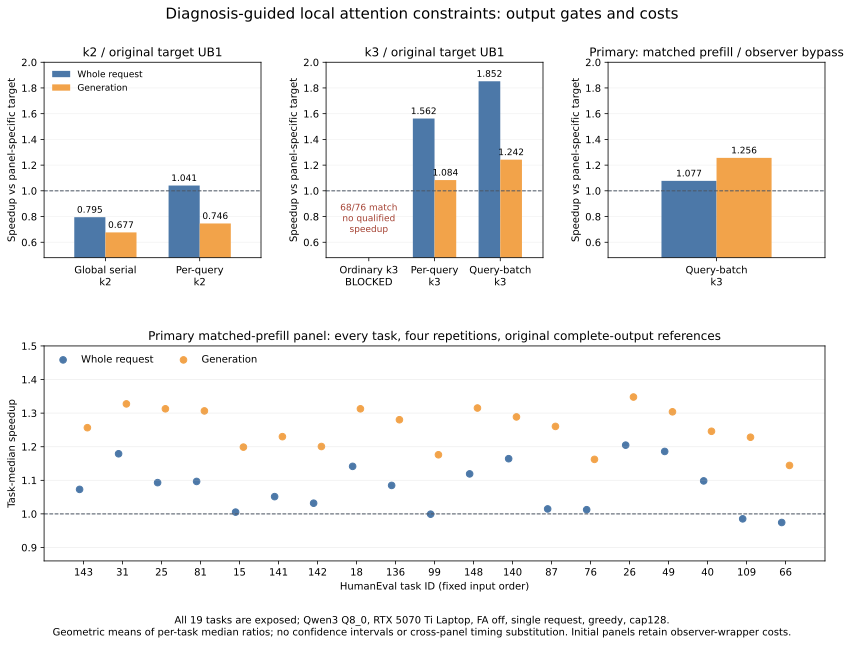

# HeteroSpec：从原 RTX 诊断到局部一致性约束的实验结果

这轮工作建立在现有论文 v0.10（main e87291d）、诊断计划 #57 和效率试验 #58 上。没有改写论文，也没有另起一个普通投机解码加速项目。现在已完成真实状态交叉诊断，以及由它引出的局部 attention 改造和速度验证。

**建议继续投入“由诊断选择局部一致性约束，保留其余批量计算”的方向。** 在严格对照下，新候选保持原19个任务的全部参考输出，生成阶段加速 **1.256倍**，整次请求加速 **1.077倍**。这是一个有实测速效的候选实现；普遍性、最小约束和独立新颖性尚待验证。

## 1. 与现有论文如何衔接

论文已经发现，RTX 上把 target continuation 的微批容量从2改为1，可以修复 /15，却使 /25 回归，/18 仍不符合参考。此前的工作能预测这些原生输出，但尚未给出便宜且可执行的修复。这次沿用原模型、CUDA、FA-off、上下文、提示词、采样和参考 token 数组，问两个问题：分歧由本次验证路径还是进入验证前的状态造成？诊断能否帮助避免全局串行的速度损失？

原论文的固定参考 R 始终保持不变。没有用普通重执行得到的另一套非参考输出替代它；也没有把 #58 的 FA-on/UB512 合同混进这次 FA-off/ctx4096 的结果。

## 2. 新诊断：真实缓存状态与当前路径存在交互

先用12次完整工程运行验证捕获和同上下文恢复不会改变原轨迹；再运行4个原诊断任务 ×2种原条件 ×3次重复，共24个完整原生 donor。每次都在历史已固定的自然边界分叉，保留实际 token 前缀、pending token、位置、KV 与真实采样器。没有 teacher forcing，也没有从空缓存重建历史。

每个 donor 分别进入容量2、容量1的 target 验证上下文，共48个分叉。24/24 原轨迹完整复现历史；24/24 同路径分叉决策与自然原生决策一致；原上下文在分叉后不变。附加标量续写最多32 token，合计1278次 forward，只用于短程诊断，不能当作完整投机复现或速度收益。

以下表格是本次验证调用实际提交的 ID，三次重复一致：

| 原任务及自然边界 | donor N0 → 当前容量2 | donor N0 → 当前容量1 | donor N1 → 当前容量2 | donor N1 → 当前容量1 |
|---|---|---|---|---|
| /15，已提交13 token | 6256,5987,9147 | 6256,5987,4199 | 6256,5987,9147 | 6256,5987,4199 |
| /25，已提交4 token | 1406 | 1406 | 1406 | 271,750,8168 |
| /18，已提交4 token | 3609,25,607 | 同左 | 同左 | 同左 |
| /31，已提交4 token | 982,262,4210 | 同左 | 同左 | 同左 |

/15 在两种 donor 上都出现当前调用路径效应；/25 只有特定 donor 与路径组合改变决策。因而，在这些检查点，仅锁定验证容量或仅比较历史状态都不充分。/18、/31 的这个检查点没有决策变化，不能推断其全轨迹都没有数值效应。

对缓存逐层、逐逻辑位置解析，而非只看序列化文件散列：12对 donor 的 prompt K/V 都完全相同，生成前缀的70/72个 K/V 张量不同，首层 K/V 相同。它支持优先测试 attention 的局部计算约束，但不能唯一证明 attention 是全部分歧的根因。尤其 /15 的最后 bonus 行在两条路径上都属于单 token 微批，不能把变化简单归因于最后一行的形状。

## 3. 用诊断提出并测试具体优化

候选保持 attention 的单查询列计算方式，同时保留投影、FFN、输出层的批量计算。先实现逐查询 attention 子图，再把查询移到 batch 维，使各查询复用 K/V 并并行执行。使用已有 CUDA 算子和张量视图，没有额外参考模型重执行、已知答案、录制 proposal 或按任务切换路径。

这两个实现都作用于8B target 和0.6B draft，覆盖 prefill 与 continuation。因此目前是整体候选约束，尚不是 target-only attention 因果消融，也不能称为已证明的最小约束。

第一组，k=2，19任务 ×3重复。相对于全局容量1的 target-only：

| 对照组 | 完整输出符合参考 | 整次请求加速 | 生成阶段加速 |
|---|---:|---:|---:|
| 全局串行 k=2 | 57/57 | 0.795× | 0.677× |
| 逐查询 attention，k=2 | 57/57 | 1.041× | 0.746× |

这个负结果很关键：逐查询 attention 的请求收益主要来自 prefill，生成阶段仍变慢。不能把它包装成 decode 加速。

第二组，固定 k=3、容量4，四条件 ×19任务 ×4平衡重复，相对于同一新前端的全局容量1 target-only：

| 对照组 | 完整输出符合参考 | 整次请求加速 | 生成阶段加速 |
|---|---:|---:|---:|
| 普通 k=3（不符合参考） | 68/76 | 未通过输出门槛 | 未通过输出门槛 |
| 逐查询 attention，k=3 | 76/76 | 1.562× | 1.084× |
| 并行查询 attention，k=3 | 76/76 | 1.852× | 1.242× |

普通 k=3 在 /25、/18 的每次重复都不符合原参考。两个约束版本均76/76符合；并行查询比逐查询子图有更好的生成速度。不过这一组的1.852倍整次收益包含更快的 prefill，而且保留了观测包装的元数据及同步成本。

第三组是应优先引用的严格对照。关闭捕获时直接调用原 decode，跳过元数据构造和强制同步；target-only 与投机版本都使用相同的容量4、并行查询 attention 和 prefill。先8/8完整探针通过，再19任务 ×2条件 ×4重复，共152次正式请求：

| 对照组 | 完整输出符合参考 | 整次请求加速 | 生成阶段加速 |
|---|---:|---:|---:|
| 并行查询 attention，k=3 | 76/76 | 1.077× | 1.256× |

所有条件仍以原参考的完整 token ID 和 EOS/128-token 边界评分。新投机版本在19/19个任务的生成阶段更快，在16/19个任务的整次请求更快。加速比是19个逐任务“四次耗时中位数比”的几何均值；不是最好一次，也不是合并所有 token 的吞吐率。整次请求包括提示处理、draft、target、回滚清理和响应；模型加载与声明的 warmup 不计入驻留服务请求。生成计时是引擎的生成阶段经过时间，包含该阶段的起草与验证，不是只计算 target kernel。

## 4. 这给论文增加什么，下一步投入什么

现在可以把主线推进为：**原生输出诊断 → 状态/路径交叉定位 → 局部一致性候选 → 同输出合同下的成本验证**。读者获得了一种可执行的诊断与约束选择流程，以及一个保留批量计算的具体实现。它比“另一程序复现原程序输出”多了一步实际工程决策。

优先级最高的是确定约束的必要范围：在冻结合同下做 target-only、draft-only、prefill-only、continuation-only 消融，并核对实际算子输入、K/V 与 CUDA 分派。目的是检验哪一部分约束足以同时通过输出与速度门槛。若只需 target attention，就能减少 draft/pre-fill 成本；若状态形成同样重要，就必须把它纳入方法。当前结果不能提前给出这个答案。

随后再做审计过暴露状态的新任务、较长输出，以及预先固定的第二模型/硬件合同。成功标准是完整参考输出与净成本共同通过，并保留失败。已有19任务和四探针均为暴露样本，不能作为保留测试集。先完成这些验证，再决定把候选提升为论文方法贡献；目前没有依据承诺正刊录用。

该方向已有相关研究。[LLM-42](https://arxiv.org/html/2601.17768v2) 已研究固定形状验证、回滚和 KV 一致性，并讨论 attention 的约束；[Thinking Machines 的工作](https://thinkingmachines.ai/blog/defeating-nondeterminism-in-llm-inference/) 已提出跨 batch 的归约一致性。因此，不能把“数值不一致会影响输出”或“固定 attention 路径”当作独立首创。我们的差异需要落在诊断如何选择更便宜的约束，以及该选择能否跨合同预测并改善一致性与效率；当前实验提供了案例，还没有完成普遍验证。

## 5. 完整性与限制

本轮合计60次完整 CLI 轨迹、627次正式驻留请求和33次排除的 warmup，共720次完整生成请求；48次诊断分叉及1278次辅助 forward 单独列账。另保留一次缺少导入的准备失败，发生于任何模型启动之前。原模型、33个发布版运行库 DLL、历史前端及输入解析代码散列检查通过，未修改原实验与论文文件。

初始速度面板包含观测包装成本；严格面板已绕过它，仍保留廉价的禁用状态检查。服务默认日志没有输出详细加载层数与微批容量；命令、冻结源代码与 CUDA 设备枚举被核对，独立 CLI 资格检查解析了完整 placement/UB 日志。原宽批面板中 ordinary_k3 的一个粗粒度元数据布尔值写错；实际冻结 runner 清除了继承的 HS 开关，并未打开改造。原始记录保留，修正在 POST_AUDIT 中明确说明。

结论限于这一 RTX、Qwen3 Q8_0、FA-off、单请求、greedy、cap128 合同。生成 ID 相同不证明全部 logits 位级相同，也不证明所有缓存填充边界一致。未测功能正确率、能耗、多请求吞吐、统计置信区间或跨平台普适性。这里的结果足以支持继续做有针对性的消融与外推验证，尚不足以把候选写成普遍无损加速定理。

