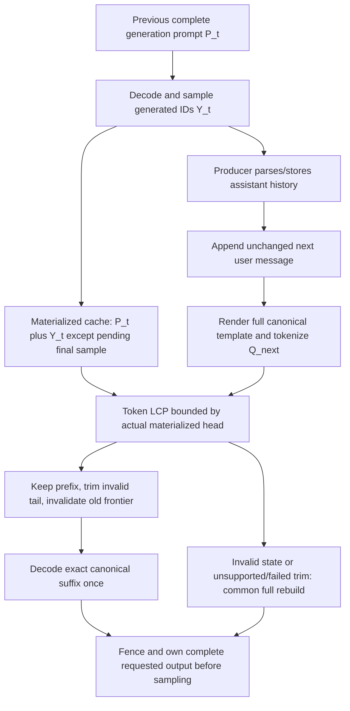

# Producer and token-state contracts

No deployed natural HeteroSpec producer was found. The diagrams describe either
audited source behavior or explicitly hypothetical saved histories. The source
matrix and exact line/hash evidence are in evidence/SOURCE_AUDIT.json. The actual
Qwen3-8B-Q8_0 and its4,100-byte GGUF template remain fixed by FREEZE.json and PR224.
Saved tokenizer provenance is vocabulary-only, add_special=false, parse_special=true;
this successor invokes no tokenizer. The template SHA is
`57f1fd00f0013a2be96aa79b857391f27e23df5b5f847072b524c897e24d0361`.

## Output to next request

For a real native EOG/cap producer, `Y_t` means the complete actually sampled ID
sequence, including an actual terminal EOG if present. Under the audited custom
worker's commit-before-next-decode policy, the materialized sequence is
`P_t || Y_t[0:-1]`; `Y_t[-1]` is pending. At cap, no EOS is invented. The full
vocabulary EOG set is `[128247,151643,151645,151662,151663,151664]`, not just151645.
Upstream server also delays decoding a sampled token until the next iteration;
its cache and returned token list therefore cannot be equated without native
receipts. Actual N heads, IDs and pending states remain unobserved.

The old N0 virtual history instead uses
`P_t || tokenize(supplied_assistant_body) || [151645]`. That final token is a
declared synthetic provided EOG, never an observed response. Its predicted
materialized head is length−1. Standalone body tokenization may itself differ from
actual generation. No teacher-forced native replay was performed.

For all1,127 later saved turns, previous `P_t` ends in
`[151667,271,151668,271]` (empty `<think>…</think>` stub); the next full canonical
render no longer contains that stub at the corresponding position. The first
difference is exactly its beginning. TOKEN_WALKTHROUGH.json gives the full exact
saved ID vectors for the first later turn in original raw order, selected without
offset/length/performance filtering. All1,645 vectors and suffixes are in the packet.

## A / B / C

| Contract | Existing evidence | Canonical input and reference implication |
|---|---|---|
| A: full canonical supplied history; any full-prefix mismatch triggers common full reset/rebuild | Frozen PR224 saved-token negative control | All later turns mismatch. Reused unchanged; no N0 rerun or native qualification. |
| B: retain raw generated sequence and append formatter suffix | Real legacy completion source machinery; current HeteroSpec has no such producer | Cannot retain the obsolete stub and also equal A's canonical next token vector. Thinking flag and formatter token-prefix guarantees are unmatched. B is not admitted or used as an equivalent cohort. |
| C: full canonical request, token-LCP reuse with tail trim/replay | Real pinned modern server implementation; N integration absent | CPU reconstructs exact A input IDs after suffix repair. Output/full-state equality remains an open qualification requirement. |

Modern CLI stores parsed content/reasoning in JSON and sends all messages to the
server. That server preserves slot prompt/KV on ordinary release, renders the full
next prompt and reconciles tokens. Parsed storage does not prove KV is discarded.
Legacy completion stores text too, yet decodes only new suffixes into the same ctx.
Neither is evidence that the corresponding N runtime is already deployed.

The inspected legacy suffix helper defaults enable_thinking=true, with no matching
nonthinking override. Its text-length suffix operation lacks a token-prefix check.
The modern server supports explicit enable_thinking=false, but its native template
engine/parser must still be version-bound and CPU-checked against the exact fixed
template; the N0 Jinja3.0.3 renderer is not automatically interchangeable with it or
with llama_chat_apply_template's recognized-template C API.

## Proposed common C reconciliation

This is a pure CPU plan in contracts.js, not native code or an alteration of A.
Let `L` be the old logical token vector, `m` the actual materialized head and `Q`
the next canonical vector. Compute `c=LCP(L,Q)` before mutating state and
`keep=min(c,m)`. If `keep==len(Q)`, back up one token to produce a fresh frontier.
Keep only `L[0:keep]`, remove seq0 positions `[keep,end)`, and decode
`Q[keep:]` at `keep`. This suffix is nonempty. The retained prefix and suffix must
reconstruct Q exactly. No string LCP, sampled argmax comparison or later equal
token can replace a token-prefix test.

Old pending token identity includes its position and producer generation. If it
is part of Q beyond the materialized prefix, decode it exactly once at that
canonical position; otherwise discard its old ownership. A newly rendered closure
token with the same ID is not proof that the old pending instance was reused.
EOG, user/assistant delimiters, empty-think, ordinary text and special token IDs all
participate in the same exact test. No assistant text, output or template fragment
is rewritten to make a match.

Trim does not create a valid output frontier. Mark the old frontier invalid and
never sample it after trim. Only successful suffix decode, synchronization and a
caller-owned complete vocabulary vector re-establish eligibility. Fully cached or
shortened prompts require an explicitly charged final-token replay. Outputs must
survive the next decode/reset; pointer reuse is not ownership.

Invalid cache, unsupported trim or declared pre-decode trim failure uses identical
full canonical reset/rebuild for R and all four arms. Preserve the failure and
charge all work. After a partial decode fails, do not hide already executed rows
inside a second rebuild: stop if the reserved request/row envelope cannot cover it.
No per-arm favorable fallback. Check prompt+cap−1<=C4096 before mutation; capacity
rejections remain in denominators. Disable silent context shifting, truncation,
chunk movement, slot eviction and multi-sequence reuse. Reset and prove empty
state between episodes, retain the same context between turns.

All four controls receive the same C lifecycle and complete legal append:
whole-rechunk+loop4, whole-rechunk+packed, LOCAL+loop4, LOCAL+packed. Current
PhaseContext SIMPLE already maximal-rechunks the whole supplied prompt; it must
not be mislabeled as an always-fixed32 caller. At predicted head205/append84,
whole-fixed is[32,19,13,20], strong whole-rechunk[32,19,32,1], LOCAL outer[32,32,20].
These are static geometry examples, not naturally observed heads.

## Guarantees and missing evidence

Executable CPU checks establish array/ID reconstruction, terminal-contract checks,
pending plans, common fallback, fresh-output requirement, capacity refusal and
ordered work geometry. Saved supplied-history reconstruction establishes neither
actual EOG nor greedy generation. Source evidence establishes available trim,
cache and ownership mechanisms, not deployed flags, actual placement or a native
context. All token/vector/KV/frontier comparisons still need N1.

The audited custom sampler is finite-logit argmax with EOG/cap only. Upstream server
can add stop strings, template stops, antiprompts, context shifts and other limits.
Before N1, freeze and echo the **effective** policies, exact parser and template
flags, cache_prompt, n_cache_reuse, ctx_shift, n_keep, slots/cache eviction and
timeouts. Do not silently suppress a real producer feature to obtain matching
results. If its canonical renderer/stop contract cannot match the declared
reference, close that producer route or create a separately reviewed protocol;
do not substitute a convenient template.
