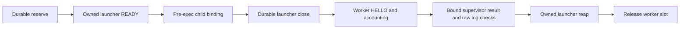

# N1a production-bridge CPU successor

Parent: Draft [#229](https://github.com/leecdiang/HeteroSpec/pull/229),
`1218f5bf81e987d6bc19a6d46bc20cc252f51639`. Its four-stage reference contract,
fixtures, original numerical archives, old STATE and accounting are protected.
This directory is an independent successor. It does not restart any prior job.

**No hardware experiment is admitted.** No model, backend or GPU context,
placement, forward, N1a/N1b/N2, timing panel or native ELF invocation is authorized
by this packet. Every one of the261 actual native checks remains `NOT_RUN`.
The Python native entry and the concrete C++ `ProductionGate` remain closed;
neither an approval-shaped JSON object nor a CPU receipt can open them.

## What this prepares

The v3 bridge binds a run, manifest, fresh lease, exact job bytes, stage, device
digest and resource-domain digest to three live roles. The controller durably
reserves the planned deployment before executing the source-pinned std-only
launcher. It registers the launcher behind a CPU READY barrier. The launcher
forks a child behind a second barrier and submits `BINDCHILD` before exec. The
controller checks kernel PID/start/boot/UID/ancestry, the inherited cgroup,
sealed worker-image FD and held job FD, and retains its own child pidfd. Only a
durable launcher-session closure permits the worker's v3 HELLO.

The worker's accounting closure retains its exclusive slot. The same registered
launcher must then supply its wait/drain/fsync result on a new authenticated
supervisor session. The controller independently checks pidfd exit visibility
and both frozen log inodes, byte lengths and full SHA-256 values. It reaps its
own launcher before releasing the slot. An exited process without the required
result stays uncertain. There is no reconnect, refund, automatic retry or reuse
of an existing STATE.

The stage gate remains resident R → independent repeat R → semantically aligned
cold canonical oracle → strong whole-rechunk+loop4. The inherited internal
consumer checks complete finite output vectors, active KV/frontier, pending,
EOG and output ownership with the original strict contract. CPU fixtures never
produce a native certificate. A cold first difference blocks strong and all
timing; no reference or tolerance is changed.

## Evidence and limits

Read `STATUS.json`, `NATIVE_ADAPTER.md`, `RESOURCE_DOMAIN.md`, `RESOURCE_PLAN.md`,
the exact unapproved execution manifest, `review/` and `CPU_EVIDENCE/`. Logs
separate synthetic state-machine setup, ordinary-file resource rehearsal, actual
std-only C++ process/IPC execution, compiler/static-reader work and actual native
checks. Passing counts from these different scopes are not pooled.

The CPU resource rehearsal uses real read-only process, ancestry, inherited
cgroup, RAM and disk observations. Its GPU lease and quota files are explicitly
synthetic. It is not an actual activated memory domain, GPU allocation or quiet
window. Read-only NVML observations of an idle device are not execution
authority. Kernel cgroup activation, atomic process placement, current external
lease authority, loaded identities, peak resource use and GPU numerical
correctness require their stated separate gates.

Pidfds, parent-death signals and deadlines constrain owned host processes. They
do not guarantee preemption of a stuck device operation or immediate GPU memory
release. An unconfirmed exit or release is `BLOCKED`, never successful cleanup.

The72 planned/76 maximum requests,69,354 planned/85,738 maximum rows,
10 deployments,553,094,505,923 available-space bytes and five-hour ceiling
remain an **unapproved proposal**. Failure allowance is not retry permission.
No old budget is reset, borrowed or consumed by these CPU accounting fixtures.

After this CPU delivery, stop for separate device, window, budget and N1a review.
Do not merge, release, edit the paper/baselines, remove old data or run N2.
