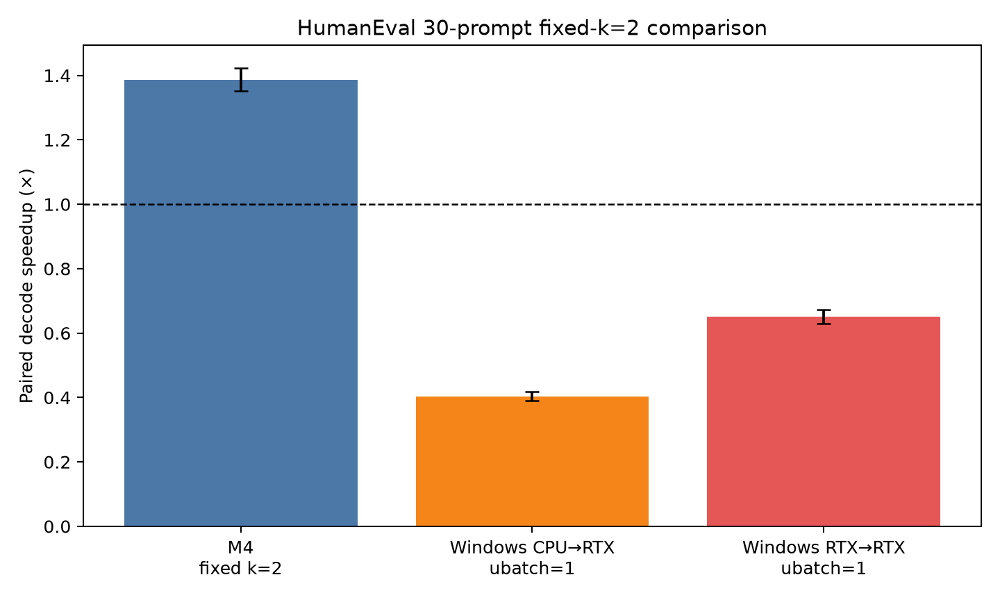
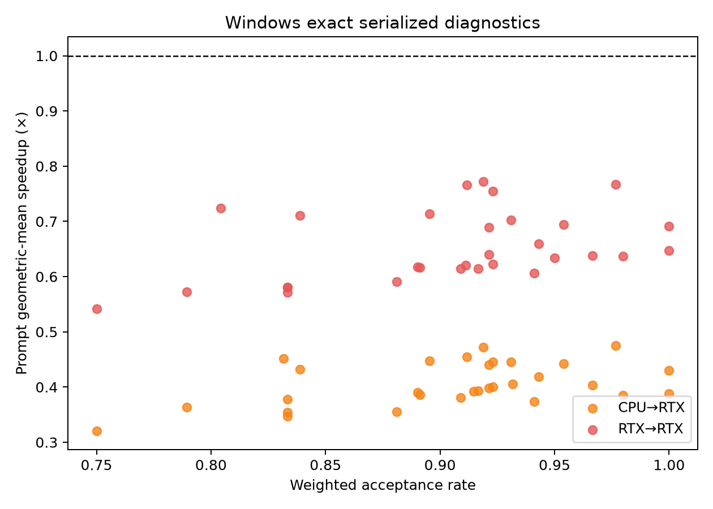

# HumanEval cross-platform comparison

## Outcome

The reported M4 result is a profitable fixed-k=2 regime: **1.387×** [1.351, 1.422], 30/30 prompts faster, 90/90 exact, 90.1% acceptance, and 1.798 accepted tokens/round. The Windows RTX 5070 Ti CUDA replication does not reproduce that regime.

| Platform / path | Status | Speedup (95% CI) | Exact | Faster prompts | Acceptance |
|---|---|---:|---:|---:|---:|
| M4 unified-memory llama.cpp/Metal | Reported valid primary | 1.387× [1.351, 1.422] | 90/90 | 30/30 | 90.1% |
| Windows CPU→RTX, CUDA `ubatch=1` | Exact serialized diagnostic | 0.404× [0.390, 0.418] | 90/90 | 0/30 | 91.31% |
| Windows RTX→RTX, CUDA `ubatch=1` | Exact serialized diagnostic | 0.650× [0.629, 0.673] | 90/90 | 0/30 | 91.21% |
| Windows CUDA batched verification | Invalid / correctness-blocked | Not reported | Failed | — | — |

## Interpretation

This is closest to **Outcome D: the architecture/backend changes the profitable boundary**, with an important correctness qualification. Acceptance is essentially held high across platforms, so workload predictability alone cannot explain the reversal. On Windows, same-card placement removes much of the heterogeneous penalty but not enough to win under the only batch setting that preserves exact output. The faster batched CUDA route fails lossless equivalence and is therefore outside the admissible experiment.

The evidence supports three bounded claims:

1. Fine-grained CPU→CUDA synchronization is costly, because RTX→RTX is materially less slow than CPU→RTX.
2. Cross-device transfer is not the sole cause, because RTX→RTX remains below one on every prompt.
3. Backend execution semantics matter: Metal produced the reported profitable, exact regime, whereas this Blackwell CUDA/Q8_0 build could not combine batched verification with token-exactness.

It does **not** justify attributing the M4 advantage solely to unified memory. The comparison simultaneously changes GPU architecture, backend kernels, scheduling, memory organization, and implementation behavior.

The M4 formal archive is now merged into `main`. Its authoritative `results.json` and raw `telemetry.csv`, all 30 frozen prompts, manifest/checksums, prompt-level summary, machine-readable aggregate, report, and figures are tracked under `artifacts/m4_humaneval_code_conditioned/`, `analysis/`, and `reports/m4/`. The M4 values in this comparison agree with that archive. The comparison CSV remains an intentionally compact cross-platform aggregate/Windows diagnostic table; readers needing M4 per-prompt values should use `analysis/m4_humaneval_prompt_summary.csv` rather than infer or reconstruct rows.

## Closure

The cross-platform replication is **CLOSED**. The registered Windows native condition failed its correctness gate; the exhaustive exact control demonstrated a robust negative performance result. No further benchmark expansion, target-size escalation, or post-hoc prompt selection is warranted on this platform.
